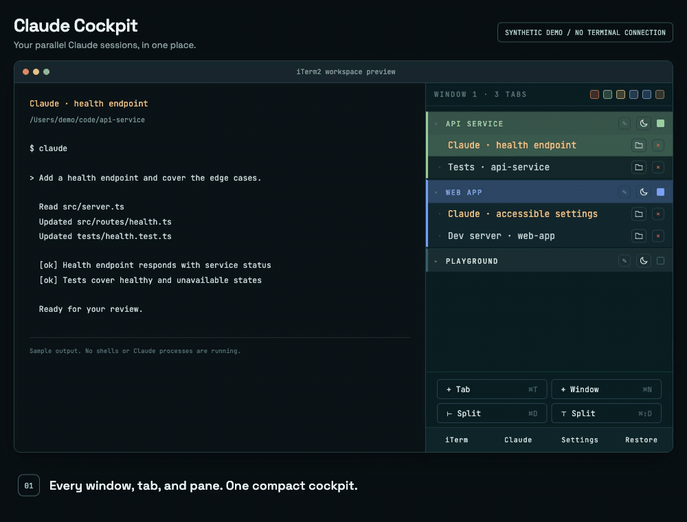

# iterm2-claude-cockpit

Live tree of every iTerm2 window, tab, and pane — purpose-built for orchestrating many Claude Code sessions side-by-side.

[](https://iterm2.com)
[](https://iterm2.com/python-api/)



The demo uses the real cockpit UI with synthetic sessions and terminal output, not a live iTerm2 connection. [Run or rebuild the walkthrough](CONTRIBUTING.md#readme-demo).

## Features

The scene numbers match the badges in the GIF, in the same order. The walkthrough stays in Classic; its before/after restore callouts are demo framing, not extra controls in the app.

| GIF scene | Feature or demo state | Details |
|-----------|-----------------------|---------|
| 01 | **Workspace overview** | A live hierarchical tree of every window → tab → pane. |
| 02 | **Focus a pane** | Click a pane to jump from Claude to its test runner; the active pane is highlighted. |
| 03 | **Switch projects** | Focus a Claude pane in another project without searching through terminal tabs. |
| 04 | **Color-code groups** | Click a tab's swatch to cycle through 6 colors, tinting its group and panes. Colors persist across restarts. |
| 05 | **Collapse a group** | Hide its panes while keeping the tab header visible. Collapsed state persists across restarts. |
| 06 | **Expand a group** | Reveal the same panes again without changing their sessions. |
| 07 | **Inspect and copy a path** | Hover the folder icon beside × to see the full working directory; click to copy it, even on an inactive pane, without changing focus. The icon is disabled when the directory is unavailable. |
| 08 | **Put a tab to sleep** | Click the **moon** between rename and the color swatch to grey out the group and collapse its panes. The name/caret and color swatch are disabled; shells and processes keep running. Sleep state survives restarts and workspace restore. |
| 09 | **Wake a tab** | Click the moon again to restore its original color and expand the panes. Only the sleep button wakes a tab. |
| 10 | **Confirm before closing** | Click the always-visible × to open the inline confirmation before closing a pane. |
| 11 | **Keep the saved layout** | The demo's test pane is now closed: 4 panes remain open, while the saved workspace still contains all 5. |
| 12 | **Preview a restore** | The **Restore** button shows how many windows, tabs, and panes will be recreated before you confirm. |
| 13 | **Restore the workspace** | Recreate saved windows, tabs, and panes as plain shells in their saved working directories. Restore creates new windows, leaves existing windows intact, and does not resume running commands. |
| 14 | **Restored workspace overview** | See the recreated window alongside the existing workspace, ready to focus panes and start new commands. |

### Additional features

- Two selectable panel themes (Settings panel → Theme): **Classic**, the default, a JetBrains Mono terminal-styled look, and **Modern**, a softer redesigned alternative. The choice persists across restarts
- Filter groups by color: click a color chip in the window header; other groups dim but stay visible
- Claude panes stand out at a glance with a yellow pane title — detected via the pane's TTY, so it works for the Node-based install too
- Auto-discovered link chips on group headers — every URL in a workspace status file becomes a labeled chip that opens in your browser (arrays open a popup of all their links); see [Group link chips](#group-link-chips) below
- Hover a pane for a tooltip with its job, working directory, and last output line
- Rename tabs inline (✎ button next to the name) or programmatically via `POST /api/rename-tab`; custom names persist until the tab or window is closed
- Create new tabs and windows from the panel
- Claude Code cheatsheet (✦ button) — a built-in quick reference of slash commands and keyboard shortcuts
- Settings panel (⚙ button) — switch the panel theme and see the plugin version at a glance
- Zero external dependencies — stdlib only, beyond the `iterm2` library bundled with iTerm2
- Runs as an AutoLaunch daemon; starts automatically with iTerm2
- Safer workspace recovery: process-directory fallback when iTerm2 cannot report a path, startup/pre-loss snapshot backups, and visible warnings for missing saved directories

## Requirements

- macOS with iTerm2 3.5 or later
- iTerm2's Python API enabled (see step 2 below)

No separate Python installation needed — iTerm2 bundles its own runtime.

## Installation

### 1. Clone and install

```bash
git clone https://github.com/igor-grubic/iterm2-claude-cockpit.git ~/code/iterm2_claude_cockpit
cd ~/code/iterm2_claude_cockpit
bash install.sh
```

`install.sh` validates iTerm2 + its bundled Python, removes any stale AutoLaunch entry from a previous install (with consent), and creates a single file symlink at:

```
~/Library/Application Support/iTerm2/Scripts/AutoLaunch/iterm2_claude_cockpit.py
```

iTerm2 runs this as a Basic script using its own bundled Python (which already has the `iterm2` library). No virtual environment to create, no "Full Environment" setup.

You can clone the repo anywhere — the symlink takes care of the AutoLaunch wiring.

### 2. Enable the Python API

`iTerm2 → Settings → General → Magic → ☑ Enable Python API`

### 3. Restart iTerm2

Cmd-Q, then reopen. Click **Allow** on the first-run API permission prompt. The daemon auto-launches on every subsequent iTerm2 start.

### 4. Show the panel

`View → Toolbelt → Show Toolbelt`, then right-click the toolbelt and tick **Claude Cockpit**.

iTerm2 remembers both settings, so this is a one-time step.

### Auto-open the panel in every new window (optional)

`Settings → Profiles → [your profile] → Window → ☑ Open toolbelt`

This is per-profile — repeat for any profile you use. Takes effect on the next new window.

### Updating

```bash
cd ~/code/iterm2_claude_cockpit && git pull
```

Then restart iTerm2. The symlink picks up your latest code automatically; no re-install needed.

### Uninstalling

```bash
bash ~/code/iterm2_claude_cockpit/uninstall.sh
# optionally also remove the repo:
rm -rf ~/code/iterm2_claude_cockpit
```

`uninstall.sh` removes only the AutoLaunch symlink; the repo is left untouched.

### Migrating from a previous install

If you installed an earlier version (folder-based Full Environment install), `install.sh` detects and offers to clean up:

- the old folder symlink at `~/Library/Application Support/iTerm2/Scripts/AutoLaunch/iterm2_claude_cockpit`
- a leftover `iterm_workflow` entry from the pre-rename name

Both must be removed for AutoLaunch to find the new file symlink at startup. If you decline the prompt, iTerm2 will keep showing a "malformed script" warning for the old folder.

Also, if you see an old **Worktree** entry in the toolbelt menu, untick it and re-tick **Claude Cockpit**.

## Session restore

Closing iTerm2 kills every pane and its processes, so in-progress work is normally lost — which makes quitting or updating iTerm2 risky. Session restore brings your workspace layout back.

As you work, the daemon saves a snapshot of your layout (windows → tabs → panes, each pane's working directory) under `~/.config/iterm2-claude-cockpit/`. If iTerm2 cannot report a pane's directory, it checks the foreground process's directory; a temporarily unavailable lookup retains the last known directory for that same session. This fallback preserves Unicode names, literal backslashes, tabs, and newlines without depending on locale settings.

Two files are kept: `state.json` mirrors your *current* layout, while `restore.json` holds the *last-good* layout that Restore recreates. The split matters — when iTerm2 relaunches it usually comes back with a single window, and keeping that degraded layout out of `restore.json` is what lets Restore still bring back your full previous workspace.

For the first ten minutes after startup, a layout with new session identities or fewer known names/directories is also protected, even if its pane count has not shrunk. After that grace period the current non-empty layout may become the new restore source. The daemon backs up the startup restore source before any refresh, and also backs up the latest saved layout before adopting fewer panes or known names/directories. `restore-backups/` retains the ten most recent backups.

Click the **⟲ Restore** button in the footer (it shows a summary — how many windows, tabs, and panes — and confirms first) to recreate the saved windows, tabs, and panes. Each pane launches directly as a shell in its saved directory; no timed `cd` keystrokes are needed. The confirmation warns if directories were never saved. Missing or deleted directories use the profile's default directory and produce a warning rather than silently reporting success. This works after both quitting/updating iTerm2 **and** a full machine reboot, because it reads from disk rather than keeping processes alive. To pick a Claude conversation back up, run `claude --continue` (or `claude --resume`) in the restored pane.

What it does **not** restore: running processes (Claude sessions, dev servers, builds — panes come back as a plain shell), terminal scrollback, and exact split sizes (panes come back as a simple vertical split). Custom tab names, group colors, collapsed state, and sleeping tabs are persisted in the same file and also survive restarts. Sleeping tabs retain their original color for when you wake them.

## Group link chips

Each group header can show small link chips that open a URL in your browser — handy for jumping from a pane straight to its pull request or ticket. The daemon is deliberately agnostic to what the links mean: it doesn't hardcode "PR" or "Jira", it just turns whatever links your status file carries into chips.

How it works:

1. In the working directories of a group's panes, it looks for a **status file** (default `.cockpit.json`).
2. Every **URL-valued property** of that file becomes a chip, **labeled with the property name**.
3. A chip with a single URL opens it on click; a chip whose property is a **list of URLs** opens a small popup listing them all.

Non-URL properties (e.g. a `branch` string) are ignored, and a group with no status file shows no chips.

**The status file.** Drop a `.cockpit.json` in a pane's working directory:

```json
{
  "jira_url": "https://jira.example.com/browse/PROJ-456",
  "pr_urls": [
    "https://github.com/org/frontend/pull/12",
    "https://github.com/org/backend/pull/34"
  ],
  "branch": "PROJ-456-do-the-thing"
}
```

This renders a **`jira_url`** chip (opens the ticket) and a **`pr_urls`** chip (opens a popup of both PRs). `branch` is ignored. The chip label is exactly the property name, so name your properties how you want them to read.

**Configuration.** The only setting is *which file* to read. To use a different filename, create `~/.config/iterm2-claude-cockpit/links.json`:

```json
{ "file": ".cockpit.json" }
```

Edits take effect on the next refresh — no restart needed. See `specs/http-api.md` for the full reference.

## Troubleshooting

**Check the console first:** `Scripts → Manage → Console` — Python tracebacks appear here.

**Verify the daemon is running:** `curl -s http://127.0.0.1:9876/` should return the panel HTML.

---

### Restored panes opened at home or tab names are missing

Check `~/.config/iterm2-claude-cockpit/restore.json` and `restore-backups/` for the original `cwd` and per-tab `name` values. A layout can have all its panes but still be missing this metadata; earlier versions protected only pane counts and did not keep backups.

To use an intact backup, stop **only the cockpit script** in `Scripts → Manage`, copy the chosen backup over `restore.json`, then start the script again and use **Restore**. Stop the script before copying so its shutdown flush cannot overwrite your selection. You do not need to quit iTerm2 or close existing panes.

The fix cannot invent paths or custom titles that were already absent from all saved copies. Recent Claude/Copilot project history can help reconstruct candidate directories, but does not reliably recover tab order or custom names.

---

### A directory lookup is rejected as ambiguous or unavailable

The daemon logs and ignores system lookup results when the directory cannot be verified or `lsof` uses ambiguous control-character notation (such as `^A`, which can also be literal filename text). It retains the last known directory for that same pane rather than guessing. Install iTerm2's shell integration (`iTerm2 > Install Shell Integration`) so iTerm2 can report paths directly; if the current directory was deleted, move into an existing directory.

---

### The panel is blank / shows "connecting…"

The daemon isn't running. Check `Scripts → Manage → Console` for Python tracebacks. If the symlink is intact and the API is enabled, restart iTerm2.

---

### AutoLaunch never started the script — no permission prompt appeared

Check the symlink exists and points at this repo:

```bash
ls -la "$HOME/Library/Application Support/iTerm2/Scripts/AutoLaunch/iterm2_claude_cockpit.py"
```

If it's missing or broken, re-run `bash install.sh` from the repo. Also confirm `Settings → General → Magic → Enable Python API` is on.

If you previously had a *folder* at the same name (from an older install), AutoLaunch will show a one-time "Cannot Run Script — malformed" warning for it. Remove it:

```bash
rm -rf "$HOME/Library/Application Support/iTerm2/Scripts/AutoLaunch/iterm2_claude_cockpit"
```

---

### The Scripts menu shows nothing / the entry doesn't appear

`Scripts → AutoLaunch` should list `iterm2_claude_cockpit.py` as a single entry. If it's missing, the symlink wasn't placed — run `bash install.sh` again.

---

### `ModuleNotFoundError` in the console

The daemon's entry script adds its own directory to `sys.path` before importing — if you see a `ModuleNotFoundError`, your symlink probably points at a wrong file. The correct target is `<repo>/iterm2_claude_cockpit/iterm2_claude_cockpit.py` (the entry **inside** the inner package). Re-run `bash install.sh` to fix it.

---

### Toolbelt shows the panel but it disappears on new windows

This is a per-profile setting. Enable it in `Settings → Profiles → [your profile] → Window → ☑ Open toolbelt` for every profile you use.

---

### The `defaults write com.googlecode.iterm2 OpenToolbelt -bool true` command doesn't work

In iTerm2 3.6+ the global `OpenToolbelt` defaults key is overridden by per-profile settings. Use the profile setting above instead.

---

### Log paths show `~/.config/iterm2/AppSupport/Scripts/...` even though I used `~/Library/Application Support/...`

iTerm2 3.6+ moved its support directory to an XDG-style path. The legacy `~/Library/Application Support/iTerm2/` location symlinks transparently to the new one — both work, the different path in logs is expected.

## Contributing

See [CONTRIBUTING.md](CONTRIBUTING.md).

## License

[MIT]
